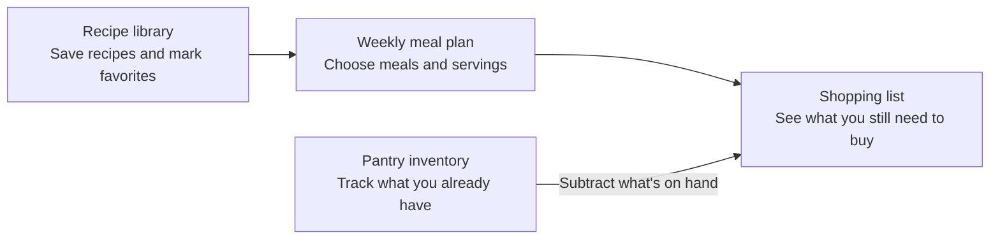
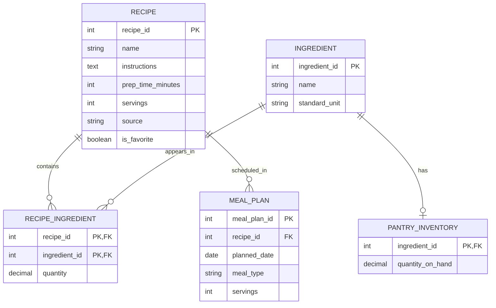
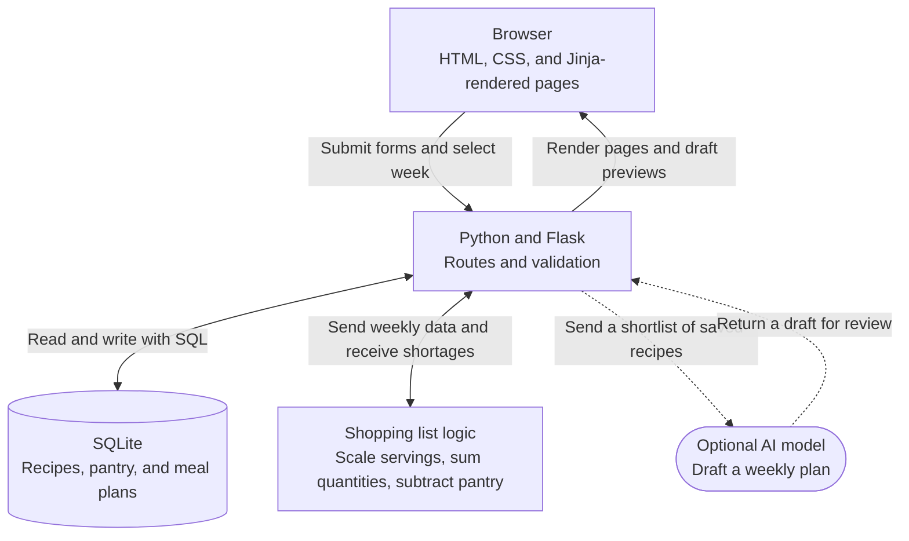

# Recipe & Meal Planner

Deciding what to cook for the week and figuring out what to buy takes enough work that I often fall back on air fryer chicken nuggets. I’m building an app that helps me save recipes, plan a week of meals, and turn that plan into a shopping list based on what I already have.

**Example.** If taco night needs two onions, soup night needs one, and I already have one, the shopping list tells me to buy **two onions**.

## Project goals

- Keep recipes from cookbooks and websites in one searchable collection, with favorites easy to find.
- Plan meals for the week and adjust ingredient quantities based on how many people I’m feeding.
- Combine ingredients across meals and subtract what’s already in the pantry.
- If time allows, try an AI planner that suggests meals with overlapping ingredients. I can review its suggestions before adding them to the plan.

## Initial ERD

Each ingredient has one standard unit, such as `each` for onions or `g` for rice. Recipe quantities and pantry quantities use that same unit. The shopping list is calculated from the selected week’s meal plan, recipe ingredients, and pantry stock.

## Rough system design

The app runs locally. Flask validates form input and uses parameterized SQL to access SQLite. If I add the AI feature, Flask checks that the suggested recipe IDs exist and saves the plan after I approve it.

## Initial daily goals

This plan runs from November 19 through December 10, 2026, the [last day of Fall 2026 classes on BYU’s academic calendar](https://catalog.byu.edu/policy/dates-and-deadlines). These are estimates. I’ll record time actually spent in [PROJECT_LOG.md](PROJECT_LOG.md) and commit and push each work session’s entry.

| Date | Goal | Planned hours |
| --- | --- | ---: |
| Nov 19 | Document the project scope, ERD, and system design. | 1 |
| Nov 20 | Set up Flask and create the SQLite schema with foreign keys. | 2 |
| Nov 21 | Load a small set of recipes, ingredients, and pantry stock for development. | 2 |
| Nov 22 | Build the recipe list and recipe detail pages. | 1 |
| Nov 23 | Add a form that saves a recipe and its ingredients in one transaction. | 2 |
| Nov 24 | Add recipe editing, deletion, search, and favorites. | 2 |
| Nov 25 | Build the pantry screen and save quantities in each ingredient’s standard unit. | 1.5 |
| Nov 26 | Thanksgiving break. | 0 |
| Nov 27 | Break or catch-up buffer. | 0 |
| Nov 28 | Build the weekly planner and save dates, meals, and servings. | 2 |
| Nov 29 | Add options to move, replace, and remove planned meals. | 1.5 |
| Nov 30 | Write the SQL query that scales servings and totals ingredients for a week. | 2 |
| Dec 1 | Subtract pantry stock and display the shopping list. | 2 |
| Dec 2 | Check the full workflow with shared ingredients, different serving counts, and an empty pantry. | 2 |
| Dec 3 | Add server validation and CSRF protection, and check recipe deletion when a meal is scheduled. | 2 |
| Dec 4 | If the core app is ready, use SQL to shortlist recipes with shared ingredients. Otherwise, fix gaps in the core workflow. | 2 |
| Dec 5 | Prototype a model-generated draft plan, or polish the manual planner if AI is out of scope. | 1 |
| Dec 6 | Validate draft recipe IDs and add a review step, or improve the shopping list experience. | 1 |
| Dec 7 | Run through the full demo and fix the issues it reveals. | 2 |
| Dec 8 | Write the final report and document the database design and how I used AI. | 2 |
| Dec 9 | Finish setup instructions, capture demo screenshots, and rehearse. | 2 |
| Dec 10 | Review the final report, reconcile logged hours, and prepare the submission. | 2 |
| **Total** | | **35** |
