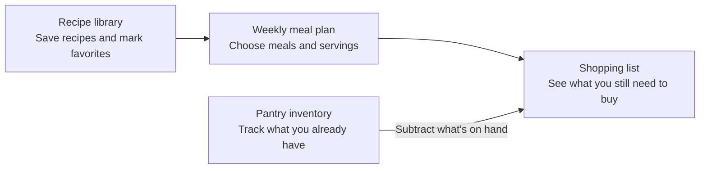

# Recipe & Meal Planner

Deciding what to cook for the week and figuring out what to buy takes enough work that I often fall back on air fryer chicken nuggets. I’m building an app that helps me save recipes, plan a week of meals, and turn that plan into a shopping list based on what I already have.

**Example.** If taco night needs two onions, soup night needs one, and I already have one, the shopping list tells me to buy **two onions**.

## Project goals

- Keep recipes from cookbooks and websites in one searchable collection, with favorites easy to find.
- Plan meals for the week and adjust ingredient quantities based on how many people I’m feeding.
- Combine ingredients across meals and subtract what’s already in the pantry.
- If time allows, try an AI planner that suggests meals with overlapping ingredients. I can review its suggestions before adding them to the plan.
